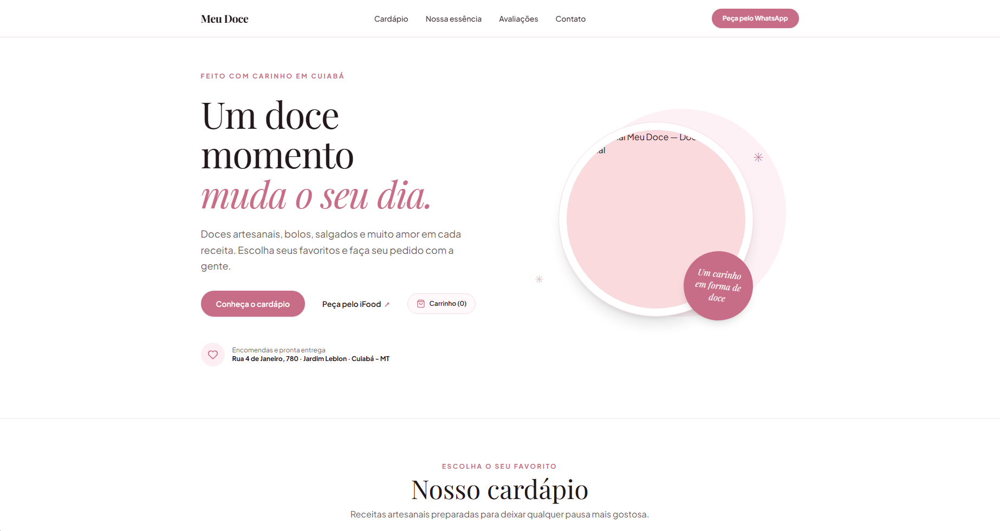

# SweetShop 

🌐 Read in: [English](README-EN.md)

This project was built to meet the needs of a growing artisanal sweets shop. The goal is to give the business a more modern online presence, making it easier to showcase its products while supporting the brand's growth.
During development, I used Google AI Studio as an opportunity to explore new tools and learn how to incorporate artificial intelligence into my workflow. 
The goal wasn't just to build a website, but also to experiment with new development approaches, complementing AI-assisted coding with independent study, research, and references from other repositories.
This project is part of my learning journey, combining a real-world need with new technologies and development practices.

**NOTE: Take a look at the [sweetshop-v1](https://github.com/arthurloni/sweetshop-v1) project, a referral site that also features case studies.**

---

🌐 Leia em: [Português](README-PT.md)

Este projeto foi desenvolvido para atender às necessidades de uma doceria artesanal em crescimento. 
A ideia é trazer uma presença digital mais moderna para o negócio, facilitando a apresentação dos produtos e acompanhando a evolução da marca.
Durante o desenvolvimento, utilizei o Google AI Studio como uma oportunidade para explorar novas ferramentas e aprender a integrar a inteligência artificial ao meu fluxo de trabalho. 
O objetivo não foi apenas construir o site, mas também experimentar novas abordagens de desenvolvimento, complementando o uso da IA com estudos, pesquisas e referências de outros repositórios.
O projeto faz parte do meu processo de aprendizado, unindo uma necessidade real a novas tecnologias e práticas de desenvolvimento.

**OBS: De uma olhada no projeto [sweetshop-v1](https://github.com/arthurloni/sweetshop-v1), um site de direcionamento, contendo tambem meus estudos.**

---

  

